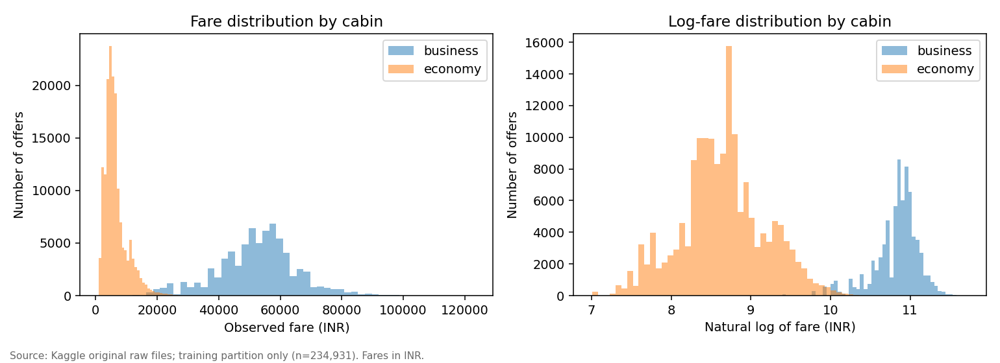
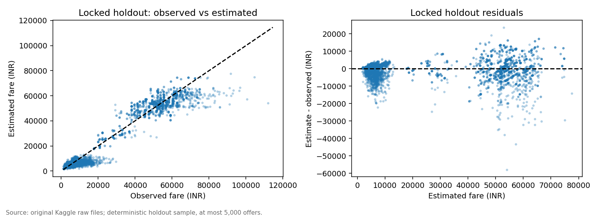
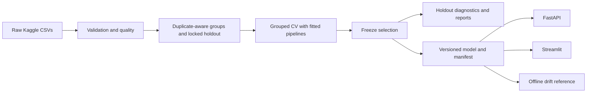

# Flight Fare Benchmark

## 1. Project overview and business problem

Estimate a **historical listed fare in INR** for an Indian domestic flight configuration.
The primary use case is retrospective travel-budget benchmarking. This is a refactor
of the existing flight-price project, retaining FastAPI, Streamlit and the original
raw dataset workflow.

**Scope:** February-March 2022 offers. No live quotes, future airfare forecasting,
optimal booking-date recommendation or verified savings claim.
[Problem statement](docs/problem_statement.md) | [Original audit](docs/project_audit.md)

## 2. Executive summary

The corrected pipeline removes invented booking lead time, groups related itineraries
before splitting, selects models through training-only cross-validation and labels
explanations in their actual output scale.

On a locked 65,324-offer holdout, the selected log-target histogram boosting model has
**INR 3,425 MAE**, versus **5,164** for a route/class median reference. The 95% group
bootstrap MAE interval is **INR 3,208-3,620**. This is a historical error improvement.
Economy MAPE remains **33.4%**, and large business-fare underpredictions remain.
[Executive summary](docs/executive_summary.md)

## 3. Why the problem matters

A useful fare benchmark should improve on a simple route/class reference while making
budget shortfall and over-allocation risks visible. A prediction is one input to a
comparison; a current supplier quote is required for a purchase.
[Success criteria](docs/success_criteria.md)

## 4. Dataset and provenance

[Shubham Bathwal's Kaggle dataset](https://www.kaggle.com/datasets/shubhambathwal/flight-price-prediction),
version 2; publisher license CC0. Original economy/business files contain 300,261 offers.
Travel dates span 11 February-31 March 2022. No per-offer observation/booking timestamp
is present; derived booking lead time is excluded.
[Dictionary and retrieval](docs/data_dictionary.md) | [Source hashes](reports/reference/sources.json)

## 5. Data quality and EDA highlights

Two exact duplicates and four malformed durations are excluded, leaving **300,255**
offers. There are **283,737 repeated canonical-feature rows**: ordinary row splitting
would let related offers cross evaluation boundaries. Eight raw carriers include
very sparse StarAir and Trujet observations.



Cabin strongly separates price distributions; carrier/route comparisons are confounded
by mix. [Quality report](docs/data_quality_report.md) | [EDA findings and five figures](docs/eda_findings.md)

## 6. Modeling methodology and validation strategy

A seed-42 group holdout reserves 699 of 3,491 components (65,324 offers); three-fold
GroupKFold develops models on 234,931 offers. Components join repeated flight identities
and identical canonical inputs without using fares. Learned preprocessing remains
inside each fold. CV MAE in INR selects the model before holdout evaluation.

No observation chronology supports a temporal test. This evaluates unseen itinerary
components within one historical sampling frame.
[Features and leakage controls](docs/feature_engineering.md) | [Evaluation](docs/model_evaluation.md)

## 7. Baseline versus selected model results

Actual executed experiment, not notebook outputs or synthetic fixtures:

| Candidate | CV MAE (INR) | Holdout MAE (INR) | Holdout RMSE (INR) |
|---|---:|---:|---:|
| Global median | 16,044 | 16,504 | 26,764 |
| Route/class median | 4,656 | 5,164 | 8,521 |
| Ridge | 4,853 | 4,837 | 7,028 |
| Decision Tree | 3,857 | 3,881 | 5,897 |
| Log-target tree | 3,735 | 3,649 | 5,726 |
| Histogram boosting | 3,574 | 3,582 | 5,333 |
| **Log-target histogram boosting** | **3,519** | **3,425** | **5,295** |

Selected-model R-squared: 0.9462; median AE: INR 2,095; MAPE: 26.38%.
[Exact results](reports/reference/model_comparison.csv) | [Selection rationale and runtimes](docs/model_selection.md)

## 8. Error analysis and explainability



Aggregate R-squared hides economy R-squared of **0.192** and business MAE of **INR 5,865**.
The largest observed miss is **INR 57,839**. Holdout has one StarAir offer and no Trujet
offers. Permutation importance measures INR MAE changes; selected-model Tree SHAP
contributions reconstruct **log(INR)** on exactly named encoded features.
[Segments and failures](docs/model_evaluation.md) | [Explanation method](docs/model_explainability.md)

## 9. Business recommendations and limitations

Use the output as a historical comparison with visible support and segment errors.
Keep route/class medians as a reference; review expensive exceptions manually.
**33.67% lower historical MAE is not 33.67% savings.**
[Business insights](docs/business_insights.md) | [Explicit impact scenarios](docs/business_impact.md) | [Limitations](docs/model_limitations.md)

## 10. System architecture



[Architecture and trade-offs](docs/architecture.md) | [API migration](docs/migration.md)

## 11. Repository structure

```text
api.py / app.py         FastAPI and Streamlit
src/schema.py          Canonical and legacy request validation
src/components/        Ingestion, transforms, candidates and metrics
src/pipeline/          Offline experiments and cached inference
src/analysis.py        Training-only EDA
src/artifacts.py       Provenance, integrity and compatibility
src/explainability.py  Aligned attributions
src/monitoring.py      Support checks and offline drift descriptors
configs/               Fixed experiment configuration
scripts/               Source retrieval and evidence publication
tests/                 Deterministic synthetic unit/integration fixtures
reports/reference/     Small actual experiment reports and figures
docs/                  Methodology, decisions, review and reproduction
artifacts/v2/          Local generated run; ignored by Git
experiment/            Archived original notebook; outputs cleared
```

## 12. Reproduction instructions

Use Python **3.12** from the repository root. Windows PowerShell:

```powershell
python -m venv .venv
.venv\Scripts\Activate.ps1
python -m pip install -r requirements_dev.txt
python scripts/download_data.py
python -m src.cli validate --data-dir data/raw --output reports/local/quality
python -m src.cli eda --data-dir data/raw --output reports/local/eda
python -m src.cli train --data-dir data/raw --output artifacts/v2 --config configs/experiment.json
python -m src.cli evaluate --data-dir data/raw --model-dir artifacts/v2 --output reports/local/evaluation
python scripts/publish_report.py --run artifacts/v2 --output reports/local/published
```

On POSIX activate with `source .venv/bin/activate`. Runtime-only install:
`python -m pip install -r requirements.txt`. The tested dependency constraints include
transitive versions; generated model manifests enforce numerical-library compatibility.
Data download needs internet; no credentials are read by the public downloader.

Use a new output directory for every repeated training run: nonempty directories are
refused. Point MODEL_DIR to that run for serving. Run metadata includes source/data/split
hashes, source snapshot, configuration, environment, CV selection and final diagnostics.
[Detailed reproduction and validation](docs/validation_results.md)

## 13. API and application demo

After training, in PowerShell:

```powershell
$env:MODEL_DIR="artifacts/v2"
python -m uvicorn api:app --host 127.0.0.1 --port 8080
# In a second activated terminal:
python -m streamlit run app.py
```

API docs: http://127.0.0.1:8080/docs. Streamlit: http://localhost:8501.
GET /ping is liveness, /health is readiness, /version records versions.
POST /predict accepts schema v2; /predict/legacy adapts original fields with warnings.

```json
{
  "airline": "AirAsia",
  "source_city": "Mumbai",
  "destination_city": "Delhi",
  "cabin_class": "economy",
  "departure_time": "Early_Morning",
  "arrival_time": "Morning",
  "duration_minutes": 140.0,
  "stops": 0
}
```

A verified local request returned **INR 3,594.67**, explicitly scoped as historical.
[Actual request/response](reports/reference/api_example.json). Add `?explain=true`
for a local explanation; individual prediction intervals are not calibrated.
Invalid requests return 422; missing models return 503; internal failures return a
sanitized 500. The former public demo URL has not been verified and is not advertised.

Docker, after training and starting Docker Desktop:

```powershell
docker build -t flight-fare-benchmark .
docker compose up --build
# API: http://localhost:8080/docs
```

Models mount read-only from artifacts/v2. Local Docker execution is unverified because
the daemon was unavailable; Compose configuration was validated.

## 14. Tests and engineering quality

```powershell
python -m pytest -q
python -m ruff check .
python -m ruff format --check .
python -m mypy
python -m build --no-isolation
python -m pip check
```

Tests cover parsers, invalid/missing/unseen inputs, immutability, leakage groups,
fold-local preprocessing, seeded models, inverse targets, artifacts, aligned explanations,
FastAPI error contracts, Streamlit prediction/validation and full synthetic training.
CI installs locked dependencies, runs checks/build validation and builds the container.
[Executed checks and limits](docs/validation_results.md)

## 15. Monitoring and operational considerations

Versioned manifests and training references support schema validation, known-support
warnings and offline categorical/numeric drift summaries. API logs report path,
status and latency without raw itineraries. There are no claimed production drift
results, live performance monitoring or automated retraining.
[Monitoring and rollback strategy](docs/monitoring_strategy.md)

## 16. Trade-offs, limitations and future improvements

Priorities are recent timestamped data, a new prospective holdout, calibrated/asymmetric
budget uncertainty, and high-cost/rare-segment reliability. Current deployment,
business impact and temporal generalization remain unproven. New infrastructure is
not a substitute for that evidence.

[Technical decisions](docs/technical_decisions.md) | [Hiring-panel review](docs/final_review.md) |
[Ten interview questions](docs/interview_preparation.md) | [Remaining roadmap](docs/roadmap.md)
