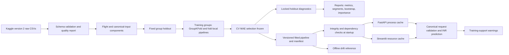

# Architecture and operation

The original FastAPI and Streamlit interfaces remain. Reusable ingestion, validation,
preprocessing, model development, evaluation, explanations and monitoring are Python
modules. The CLI coordinates offline work; importing training performs no I/O.

The fitted estimator contains all learned transformations. Source dates and clock
formats are converted by pure shared helpers before fitting; public canonical requests
use the same features directly. A route/class median is a deliberately simpler
DataFrame estimator and has no unnecessary encoder.

A run directory holds config, source hashes, split assignments/hash, source snapshot,
environment pins, model.joblib, manifest, CV progress and frozen selection, final
metrics, predictions, segments, large errors, figures and explanation diagnostics.
Existing nonempty run directories are refused. Data and binary run artifacts are
ignored by Git; small curated evidence is published in reports/reference.

Manifest schema v2 records Python minor and exact numerical-library versions, feature
order, file hash, training reference, provenance, selection, metrics and target scale.
Only trusted local artifacts are deserialized; hashes detect corruption, not malicious
models or a forged manifest. Do not accept model uploads or load unknown pickles.
Legacy unversioned artifacts are never a fallback.

FastAPI loads once at lifespan startup. /ping is liveness, /health is readiness and
returns 503 without a compatible model. /version exposes application/schema/model
versions. Requests use strict Pydantic validation; model failures return sanitized 500
responses and are logged internally. Request logs contain status/path/latency without
input payloads. Explanation work is optional; global reports are generated offline.

Streamlit caches the model, displays historical scope and support warnings, derives
carrier prefix from the selected airline, and validates explicit clock/duration
consistency. New code avoids current-date features.

Docker runs one API process as an unprivileged user; models are mounted read-only,
not embedded. A healthcheck targets readiness. Dependencies use a tested constraints
file. The Python base tag is versioned but not digest-pinned; a release should pin a
verified image digest and perform vulnerability review. No container execution or
public deployment is implied merely by configuration.

See [migration](migration.md), [monitoring](monitoring_strategy.md) and
[validation evidence](validation_results.md) for practical limits.
